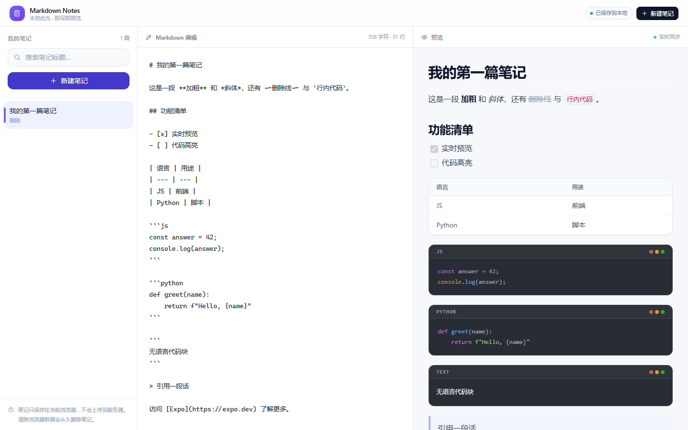

# Markdown Notes

一个**零后端、零登录、数据只留在浏览器里**的 Markdown 笔记应用。左侧编辑、右侧实时预览，支持 GFM 表格 / 任务列表 / 删除线、代码块语法高亮与本地持久化，构建产物可直接部署到 **GitHub Pages**。



## 功能

- **实时预览**：受控编辑器 + `useDeferredValue`，输入即渲染，大文档输入不阻塞编辑。
- **Markdown 渲染**：标题、粗体 / 斜体 / 删除线、列表、任务列表、引用、链接、图片、表格、分割线、行内代码、代码块。
- **代码高亮**：基于 Prism 的 One Dark 主题，覆盖 JavaScript / TypeScript / Python / Java / Go / Rust / SQL / JSON / Bash 等常见语言；未标注或未知语言自动降级为纯文本，不报错。
- **笔记管理**：新建、切换、删除（二次确认）、按标题实时搜索（忽略大小写）；删除当前笔记后自动选中下一条。
- **本地持久化**：笔记与当前选中项写入 LocalStorage，刷新 / 关闭浏览器后恢复。
- **异常降级**：LocalStorage 不可用或空间已满时给出非阻断提示，编辑不中断。
- **响应式**：桌面端三栏（列表 / 编辑 / 预览）；移动端抽屉式笔记列表 + 编辑 / 预览 Tab，适配 375px 宽度。
- **可访问性**：按钮均有可读文本或 `aria-label`，搜索框关联标签，删除弹窗支持 Esc 与焦点恢复。
- **可部署**：内置 GitHub Actions 工作流，使用相对基路径，无需把仓库名写进配置。

## 技术栈

| 领域     | 技术                                                         |
| :------- | :----------------------------------------------------------- |
| 框架     | React 18 + TypeScript（`strict`）                            |
| 构建     | Vite 5                                                       |
| Markdown | `react-markdown` + `remark-gfm`（GFM 表格 / 任务列表 / 删除线） |
| 代码高亮 | `react-syntax-highlighter`（Prism）+ One Dark                |
| 样式     | Tailwind CSS 3                                               |
| 存储     | 浏览器 LocalStorage                                          |
| 部署     | GitHub Pages + GitHub Actions                                |

> `remark-gfm` 是 PRD 要求「表格、任务列表、删除线」所必需的 GFM 插件，不引入第二套 Markdown 解析器。

## 本地开发

要求 Node.js **>= 18.18**，包管理器使用 **npm**。

```bash
npm install
npm run dev       # 启动开发服务器
npm run build     # 类型检查 + 生产构建（输出到 dist/）
npm run preview   # 本地预览构建产物
npm run lint      # ESLint 检查
```

## 部署到 GitHub Pages

仓库已内置 `.github/workflows/deploy.yml`，推送到 `main` 分支即可自动构建并发布。

1. 在 GitHub 新建仓库，把本项目推送上去（默认分支为 `main`）。
2. 打开仓库 **Settings → Pages → Build and deployment**，把 **Source** 设为 **GitHub Actions**。
3. 推送到 `main`，或在 **Actions** 页面手动运行 **Deploy to GitHub Pages**。
4. 等待工作流完成，访问 `https://<你的用户名>.github.io/<仓库名>/`。

### 为什么不需要改 `base`

`vite.config.ts` 使用 `base: './'`，构建后的资源路径是相对的：

- 放在 `https://<user>.github.io/<repo>/` 项目页可以正常加载；
- 放在用户主页 `https://<user>.github.io/` 或自定义域名下同样可用；
- 本应用没有前端路由，刷新页面不会出现 404。

如果默认分支不是 `main`，修改 `.github/workflows/deploy.yml` 中的 `branches` 即可。

### 部署检查清单

- 仓库 **Settings → Pages → Source** 已选择 **GitHub Actions**；
- 工作流对 `pages: write` / `id-token: write` 有权限（文件内已声明）；
- 首次部署需要等待 Actions 完成，之后每次推送自动更新；
- 部署后的笔记数据保存在**当前域名对应的浏览器 LocalStorage** 中，与本地 `localhost` 的数据互不相通。

## 数据与隐私

- 所有笔记仅保存在当前浏览器的 LocalStorage，键名为 `markdown-notes:notes` 与 `markdown-notes:activeId`。
- 不上传服务器、不做账号体系、不接入分析或监控 SDK。
- 清除浏览器数据会永久删除笔记；界面中已做提示。
- 浏览器隐私模式下 LocalStorage 可能不可用，此时应用降级为内存态并提示，刷新后修改会丢失。

## 目录结构

```text
.
├── .github/workflows/deploy.yml   # GitHub Pages 自动部署
├── public/                        # favicon、.nojekyll
├── src/
│   ├── components/
│   │   ├── ConfirmDialog.tsx      # 删除二次确认弹窗
│   │   ├── Editor.tsx             # Markdown 编辑器
│   │   ├── Icons.tsx              # 内联 SVG 图标
│   │   ├── MarkdownRenderer.tsx   # react-markdown + 代码高亮
│   │   ├── NoteList.tsx           # 搜索、新建、列表、删除
│   │   ├── Preview.tsx            # 预览滚动容器与空状态
│   │   └── Welcome.tsx            # 首次使用 / 无选中笔记
│   ├── hooks/useNotes.ts          # 笔记状态、搜索、持久化
│   ├── types/note.ts              # Note 类型
│   ├── utils/
│   │   ├── note.ts                # 标题推导、排序、日期格式化
│   │   └── storage.ts             # LocalStorage 读写与容错
│   ├── App.tsx                    # 三栏布局与响应式
│   ├── index.css
│   └── main.tsx
├── index.html
├── tailwind.config.js
├── vite.config.ts
└── package.json
```

## 已验证场景

- 新建 / 切换 / 搜索 / 删除笔记，删除取消与确认；
- 删除当前笔记后自动选中下一条；
- 实时预览、GFM 表格、任务列表、行内代码、JS / Python 代码高亮、无语言代码块；
- 刷新后内容、标题与当前选中笔记恢复；
- 375px 宽度无横向溢出，移动端抽屉与编辑 / 预览 Tab 可用；
- LocalStorage 写入失败（隐私模式 / 配额满）：出现提示且可继续编辑；
- 损坏的 JSON、失效的 `activeId`：降级为空状态，不白屏。

## License

MIT
