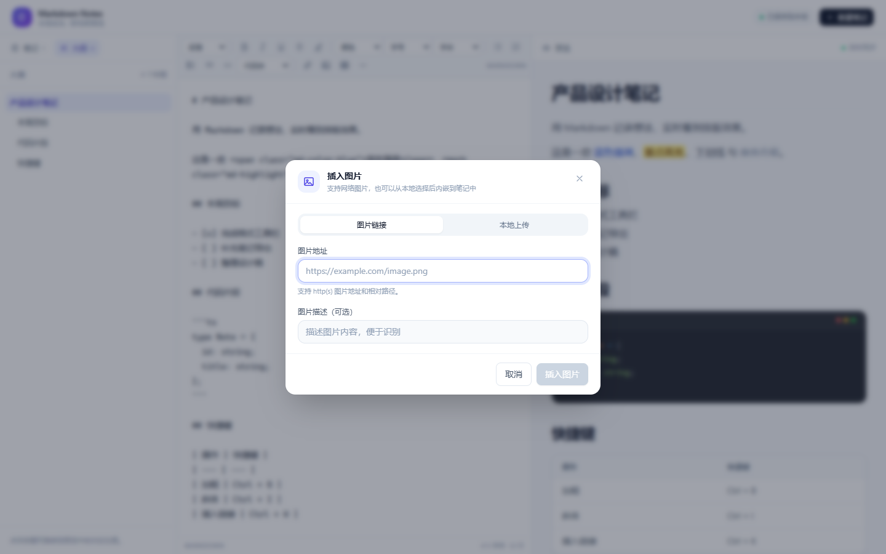

# Markdown Notes

一个**零后端、零登录、数据只留在浏览器里**的 Markdown 笔记应用。左侧编辑、右侧实时预览，提供 Typora 类格式工具栏、字体颜色 / 字号 / 字体、图片插入、大纲导航、GFM 表格 / 任务列表、代码高亮与本地持久化，构建产物可直接部署到 **GitHub Pages**。


## 功能

### 编辑与格式

- **格式工具栏**：段落 / 标题级别、加粗、斜体、下划线、删除线、高亮、无序 / 有序 / 任务列表、引用、行内代码、代码块、链接、图片、表格、分割线。
- **字体样式**：颜色（10 种）、字号（5 档）、字体（默认 / 衬线 / 等宽）与高亮；样式以带 `md-*` 类名的安全 HTML 写入笔记，预览中即时生效。
- **快捷键**：`Ctrl/Cmd + B` 加粗、`Ctrl/Cmd + I` 斜体、`Ctrl/Cmd + E` 行内代码、`Ctrl/Cmd + K` 插入链接。
- **代码块**：工具栏选择语言后插入带围栏的代码块，支持 JavaScript / TypeScript / Python / Java / Go / Rust / SQL / JSON / Bash / HTML / CSS 等。
- **图片插入**：支持图片 URL、本地上传、直接粘贴图片、拖拽图片到编辑器；本地图片会压缩后以 base64 内嵌，刷新不丢失。



### 大纲与预览

- **大纲导航**：左侧栏「大纲」Tab 自动提取 h1–h6 标题，点击跳转到预览对应位置，并随预览滚动高亮当前标题。
- **实时预览**：受控编辑器 + `useDeferredValue`，输入即渲染，大文档输入不阻塞编辑。
- **Markdown 渲染**：标题、粗体 / 斜体 / 删除线、列表、任务列表、引用、链接、图片、表格、分割线、行内代码、代码块。
- **代码高亮**：基于 Prism 的 One Dark 主题；未标注或未知语言自动降级为纯文本，不报错。

### 笔记管理与本地优先

- **笔记管理**：新建、切换、删除（二次确认）、按标题实时搜索（忽略大小写）；删除当前笔记后自动选中下一条。
- **本地持久化**：笔记与当前选中项写入 LocalStorage，刷新 / 关闭浏览器后恢复。
- **异常降级**：LocalStorage 不可用或空间已满时给出非阻断提示，编辑不中断。
- **响应式**：桌面端三栏（列表 / 编辑 / 预览）；移动端抽屉式笔记列表 + 编辑 / 预览 Tab，适配 375px 宽度。
- **可访问性**：按钮均有可读文本或 `aria-label`，搜索框关联标签，弹窗支持 Esc 与焦点恢复。
- **可部署**：内置 GitHub Actions 工作流，使用相对基路径，无需把仓库名写进配置。

## 技术栈

| 领域       | 技术                                                          |
| :--------- | :------------------------------------------------------------ |
| 框架       | React 18 + TypeScript（`strict`）                             |
| 构建       | Vite 5                                                        |
| Markdown   | `react-markdown` + `remark-gfm`（GFM 表格 / 任务列表 / 删除线） |
| 富文本安全 | `rehype-raw` + `rehype-sanitize`（白名单 HTML + `md-*` 类名）  |
| 代码高亮   | `react-syntax-highlighter`（Prism）+ One Dark                 |
| 样式       | Tailwind CSS 3                                                |
| 存储       | 浏览器 LocalStorage                                           |
| 部署       | GitHub Pages + GitHub Actions                                 |

> `remark-gfm` 是 GFM 表格、任务列表、删除线所必需的插件；`rehype-raw` 仅用于渲染工具栏生成的格式标签，并经过 `rehype-sanitize` 白名单过滤，不引入第二套 Markdown 解析器。

## 安全说明

- 所有笔记只在本机浏览器处理，不上传服务器。
- 笔记中的原始 HTML 会先经过 `rehype-sanitize`：
  - 只允许 `span` / `mark` / `u` / `sub` / `sup` / `kbd` 等安全标签；
  - 只允许 `md-*` 类的样式类名；
  - 移除 `<script>`、事件属性（如 `onerror`）与危险 URL 协议。
- 本地图片只接受 PNG / JPEG / WebP / GIF，拒绝 SVG；插入前会压缩到最长边 1600px。
- 应用默认不发起任何网络请求；只有你主动填写远程图片 URL 时，浏览器才会加载该图片。

## 使用技巧

- 选中文字后点击工具栏按钮，会把选区包裹为对应 Markdown / HTML；没有选区时会插入占位文字并自动选中。
- 点击「颜色」「字号」「字体」下拉框可对选中文字叠加样式。
- 在编辑器内直接粘贴截图，或把图片文件拖入编辑区，即可插入图片。
- 大纲位于左侧栏「大纲」Tab；点击标题会切换到预览并滚动到对应位置。

> 颜色 / 字号 / 字体使用 HTML 标签写入 Markdown 源文件，这是为了在不引入 WYSIWYG 编辑器的前提下保留 Markdown 可编辑性；预览中会以样式呈现。

## 本地开发

要求 Node.js **>= 18.18**，包管理器使用 **npm**。

```bash
npm install
npm run dev       # 启动开发服务器
npm run build     # 类型检查 + 生产构建（输出到 dist/）
npm run preview   # 本地预览构建产物
npm run lint      # ESLint 检查
```

## 部署到 GitHub Pages

仓库已内置 `.github/workflows/deploy.yml`，推送到 `main` 分支即可自动构建并发布。

1. 在 GitHub 新建仓库，把本项目推送上去（默认分支为 `main`）。
2. 打开仓库 **Settings → Pages → Build and deployment**，把 **Source** 设为 **GitHub Actions**。
3. 推送到 `main`，或在 **Actions** 页面手动运行 **Deploy to GitHub Pages**。
4. 等待工作流完成，访问 `https://<你的用户名>.github.io/<仓库名>/`。

### 为什么不需要改 `base`

`vite.config.ts` 使用 `base: './'`，构建后的资源路径是相对的：

- 放在 `https://<user>.github.io/<repo>/` 项目页可以正常加载；
- 放在用户主页 `https://<user>.github.io/` 或自定义域名下同样可用；
- 本应用没有前端路由，刷新页面不会出现 404。

如果默认分支不是 `main`，修改 `.github/workflows/deploy.yml` 中的 `branches` 即可。

### 部署检查清单

- 仓库 **Settings → Pages → Source** 已选择 **GitHub Actions**；
- 工作流对 `pages: write` / `id-token: write` 有权限（文件内已声明）；
- 首次部署需要等待 Actions 完成，之后每次推送自动更新；
- 部署后的笔记数据保存在**当前域名对应的浏览器 LocalStorage** 中，与本地 `localhost` 的数据互不相通。

### 白屏排查

如果页面白屏，且浏览器控制台出现 `Failed to load resource: .../src/main.tsx`：

- 说明 GitHub Pages 仍在 **Deploy from a branch**，发布的是仓库源码而不是 `dist` 构建产物；
- 把 Pages 的 **Source** 改为 **GitHub Actions**，然后重新运行 `Deploy to GitHub Pages` 工作流；
- 正常部署后，页面加载的应是 `./assets/index-*.js`，而不是 `/src/main.tsx`。

## 数据与隐私

- 所有笔记仅保存在当前浏览器的 LocalStorage，键名为 `markdown-notes:notes` 与 `markdown-notes:activeId`。
- 本地图片以 base64 内嵌在笔记内容中，同样占用 LocalStorage 空间；建议单张图片不超过 2MB。
- 不上传服务器、不做账号体系、不接入分析或监控 SDK。
- 清除浏览器数据会永久删除笔记；界面中已做提示。
- 浏览器隐私模式下 LocalStorage 可能不可用，此时应用降级为内存态并提示，刷新后修改会丢失。

## 目录结构

```text
.
├── .github/workflows/deploy.yml   # GitHub Pages 自动部署
├── docs/                          # README 截图
├── public/                        # favicon、.nojekyll
├── src/
│   ├── components/
│   │   ├── ConfirmDialog.tsx      # 删除二次确认弹窗
│   │   ├── Editor.tsx             # 编辑器、选区编辑、图片粘贴/拖拽
│   │   ├── EditorToolbar.tsx      # 格式工具栏
│   │   ├── ImageDialog.tsx        # 图片链接 / 本地上传弹窗
│   │   ├── Icons.tsx              # 内联 SVG 图标
│   │   ├── MarkdownRenderer.tsx   # react-markdown + 高亮 + HTML 净化
│   │   ├── NoteList.tsx           # 搜索、新建、列表、删除
│   │   ├── OutlinePanel.tsx       # 大纲列表
│   │   ├── Preview.tsx            # 预览、标题 id、滚动高亮
│   │   ├── Sidebar.tsx            # 笔记 / 大纲切换侧边栏
│   │   └── Welcome.tsx            # 首次使用 / 无选中笔记
│   ├── hooks/useNotes.ts          # 笔记状态、搜索、持久化
│   ├── types/
│   │   ├── note.ts                # Note 类型
│   │   └── outline.ts             # OutlineItem 类型
│   ├── utils/
│   │   ├── image.ts               # 本地图片压缩 / data URL
│   │   ├── markdownEdits.ts       # 选区包裹、列表、代码块等编辑操作
│   │   ├── note.ts                # 标题推导、排序、日期格式化
│   │   ├── outline.ts             # 标题 slug / 唯一 id
│   │   └── storage.ts             # LocalStorage 读写与容错
│   ├── App.tsx                    # 三栏布局、响应式、大纲联动
│   ├── index.css                  # Tailwind + md-* 样式类
│   └── main.tsx
├── index.html
├── tailwind.config.js
├── vite.config.ts
└── package.json
```

## 已验证场景

- 新建 / 切换 / 搜索 / 删除笔记，删除取消与确认；
- 删除当前笔记后自动选中下一条；
- 加粗、斜体、下划线、删除线、高亮、颜色、字号、字体；
- 代码块语言选择与语法高亮、表格、任务列表、行内代码；
- 图片 URL、本地上传、压缩为 WebP、刷新后恢复；
- 大纲生成、标题 id、点击跳转、滚动高亮、移动端大纲跳转；
- 原始 HTML 的白名单渲染：`md-*` 样式生效，`script` / `onerror` 被移除；
- 刷新后内容、标题、图片与当前选中笔记恢复；
- 375px 宽度无横向溢出，移动端抽屉、工具栏与编辑 / 预览 Tab 可用；
- LocalStorage 写入失败（隐私模式 / 配额满）：出现提示且可继续编辑；
- 损坏的 JSON、失效的 `activeId`：降级为空状态，不白屏。

## 已知取舍

- 格式颜色 / 字号 / 字体使用 HTML 标签写入源码，因此编辑区会看到 `<span class="md-*">`；这是保持 Markdown 可编辑性的取舍，不是 WYSIWYG。
- 本地图片以 base64 存储，LocalStorage 容量约 5MB，插入多张较大图片可能触发容量提示；后续可迁移 IndexedDB。
- Prism 全量语言包与 `rehype-raw` 使主 JS 约 **399KB gzip**，换取开箱即用的高亮与格式能力；后续可按需裁剪语言包。

## License

MIT
